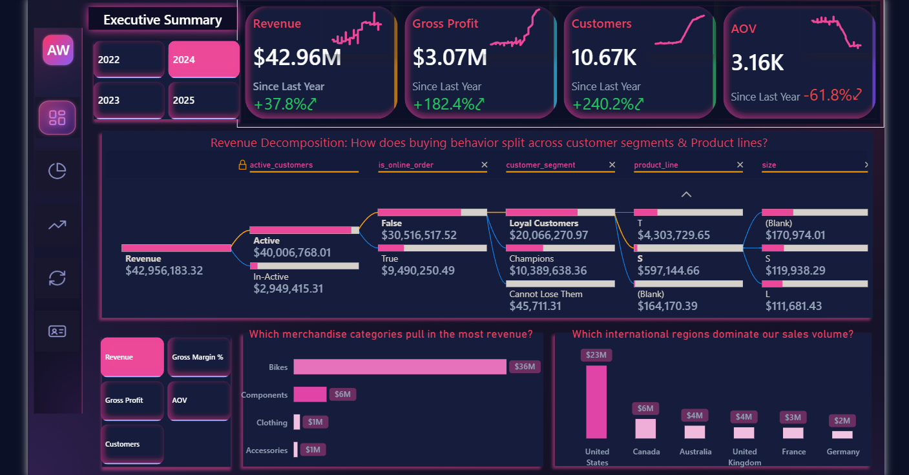

# 📊 Phase 7: Power BI Dashboards

---
**📅 Document Created**: Oct 2026
**👤 Author**: Amr Bayomei Basha
**🏢 Project**: AdventureWorks End-to-End Customer Analytics
**📂 Phase**: phase_7_power_bi_dashboards
---

The report layer of the AdventureWorks2025 customer analytics platform. Five pages sit on the [Power BI semantic model](../semantic_modeling/) built over the Gold layer of the SQL Server warehouse, and the Forecasting page also reads the predictions written back to Gold by the [Python BTYD notebook](../btyd_python/).

Every page is titled with the business question it answers, and every number on it comes from a model measure, not from logic inside a visual.

| | |
|---|---|
| **File** | [`adventureworks2025_customer_analyticsV2.pbix`](adventureworks2025_customer_analyticsV2.pbix) |
| **Source** | `AdventureWorks2025_CustomerDW`, Gold schema (SQL Server) |
| **Pages** | 4 analysis pages + 1 drill-through page |
| **Canvas** | 1280 × 720, dark theme, shared side navigation |
| **Interactivity** | page navigation buttons, 3 "Page Info" bookmark panels, 2 field-parameter slicers, decomposition tree, drill-through |

---

## 🗺️ Report Map

```text
            ┌──────────────────────────────────────────────┐
            │  Side navigation (on every page)             │
            └──────────────────────────────────────────────┘
                 │          │            │            │
                 ▼          ▼            ▼            ▼
          1 Executive   2 RFM       3 Customer    4 Customer
            Summary     Customer    Forecasting   Retention
                        Intelligence  (BTYD)       Analytics
                            │            │
                            └─────┬──────┘
                                  ▼  drill-through
                          5 Customer Details
                     (filtered by customer_segment
                          or action_segment)
```

| # | Page | Business question | Main fact table |
|---|---|---|---|
| 1 | Executive Summary | How is the business performing, and where does revenue come from? | `fact_sales` |
| 2 | RFM Customer Intelligence | Who are our most valuable and most at-risk customers, and what should we do with each group? | `fact_customer_analytics` |
| 3 | Customer Forecasting | What will customers buy in the next 90 days, and how far can we trust that forecast? | `fact_customer_btyd_predictions`, `fact_customer_btyd_eval` |
| 4 | Customer Retention Analytics | Are newer customer cohorts better or worse? | `fact_customer_cohort` |
| 5 | Customer Details | Exactly which customers are in this segment? | `fact_customer_analytics`, `fact_customer_btyd_predictions` |

---

## 1) Executive Summary



**Purpose:** a one-screen view of sales performance for leadership, with a path from the headline number down to the customer segment and product line behind it.

| Visual | What it shows | Measures / fields |
|---|---|---|
| KPI cards with sparklines | Revenue, Gross Profit, Customers, AOV, each with change vs last year and a 3-month rolling trend line | `Revenue`, `Gross Profit`, `Customers`, `AOV`, `Rolling Avg 3M …` |
| Year slicer | 2022 to 2025 tiles | `dim_date[year]` |
| Decomposition tree | Revenue split by active/inactive customer → online vs offline → RFM segment → product line → size | `active_customers`, `is_online_order`, `customer_segment`, `product_line`, `size` |
| Metric switcher | Changes the decomposition tree between Revenue, Gross Profit, Customers, Gross Margin % and AOV | field parameter `Metrics` |
| Bar chart | Which merchandise categories pull in the most revenue? | `Revenue` by `category_name` |
| Column chart | Which international regions dominate our sales volume? | `Revenue` by `country_name` |

**Reading it (2024 selected):** revenue $42.96M (+37.8%), gross profit $3.07M (+182.4%) and customers 10.67K (+240.2%) all grew, while AOV fell 61.8% to $3.16K. Growth came from many more, smaller orders. Bikes bring about $36M of revenue and the United States about $23M.

---

## 2) RFM Customer Intelligence


**Purpose:** segment customers by Recency, Frequency and Monetary value, and turn each segment into an action a marketing team can run.

| Visual | What it shows | Measures / fields |
|---|---|---|
| KPI cards | Purchased customers, high-value customers (Champions + Loyal), at-risk customers (About To Sleep + Hibernating + Lost), median days since last purchase | `Purchased Customers`, `High Value Customers`, `At Risk Customers`, `Median Days Since Purchase` |
| Treemap | Customer count per RFM segment; tooltips add revenue, gross profit, margin and AOV | `customer_segment` |
| Segment action panel | Select a segment to see its customer profile, recommended action plan and success KPI | `MAC_Customer_Profile`, `MAC_Marketing_Strategy`, `MAC_Primary_KPI`, `MAC_Segment_Share` |

The action panel reads the static `dim_segment_playbook` table in the semantic model, so the recommendation for each segment is defined once and reused everywhere.

**Reading it:** 19.12K purchasing customers and $109.85M lifetime revenue. 2.43K customers are high value and 2.45K are at risk. The median customer last bought 165 days ago. The largest segments are Needs Attention (4.76K) and Recent Customers (4.03K).

**Questions answered:** who are our most valuable customers, which are risky, how do customers differ, and what action should each group get.

---

## 3) Customer Forecasting (BTYD)


**Purpose:** show the output of the Python Buy-Till-You-Die models (Modified BG/NBD for purchases, Gamma-Gamma for order value) next to their validation on a 90-day holdout, and route customers into marketing actions.

| Visual | What it shows | Measures / fields |
|---|---|---|
| KPI cards | 90-day revenue forecast, predicted purchases, actual holdout purchases, mean absolute error | `BTYD_Projected_Revenue_90d`, `Predicted Purchases`, `Actual Holdout Purchases`, `BTYD_Model_MAE` |
| Matrix: Who is buying vs. who is slipping away? | Customers by `alive_status` (One-Time Buyer, Active, Cooling, Lapsed Repeat) and predicted `value_tier` (Low, Medium, High, Top) | `Customers` |
| Column chart: How should we distribute marketing actions? | Customers per `action_segment` | `Customers` |
| Scatter: How accurately did the model predict holdout behavior? | Predicted vs actual holdout purchases per customer | `predicted_holdout_purchases`, `actual_holdout_purchases` |
| Table: Which profiles should we target next? | Customer list with 90-day revenue forecast and action segment | `predicted_revenue_90d`, `action_segment` |

**Reading it, honestly:**

| Check | Result |
|---|---|
| Purchases, 90-day holdout | 2,655 predicted vs 2,475 actual (+7.3%) |
| Revenue, 90-day holdout | $9.20M predicted vs $5.64M actual (+63%) |
| Per-customer MAE | 0.27, worse than the 0.23 of a simple "each customer's own past rate" baseline |

The total purchase count is close, but per-customer predictions and revenue are not reliable on this dataset. `alive_status`, `value_tier` and `action_segment` are transparent business rules, not model-validated targeting, and any campaign built on them should be run against a control group. The full evaluation is in [`btyd_python/`](../btyd_python/).

| Action segment | Rule | Customers |
|---|---|---|
| Second-Purchase Campaign | One-Time Buyer | 10,428 |
| Retain & Grow | Active, High or Top tier | 3,131 |
| Nurture | Active, other tiers | 1,711 |
| Win-Back | Cooling or Lapsed, other tiers | 707 |
| Win-Back High Value | Cooling or Lapsed, High or Top tier | 323 |

---

## 4) Customer Retention Analytics


**Purpose:** track monthly acquisition cohorts to see whether customers come back, and whether newer cohorts behave better or worse than older ones.

| Visual | What it shows | Measures / fields |
|---|---|---|
| KPI cards | Retention rate, churn rate, acquisition (first-month) revenue, repeat-customer revenue, repeat revenue share | `Retention Rate`, `Churn Rate`, `New Customers Revenue`, `Repeat Customers Revenue`, `Repeat Revenue Share %` |
| Cohort matrix | Rows are acquisition months, columns are months since first purchase | `cohort_month`, `Period Label` |
| Metric switcher (pill slicer) | Changes the matrix between Retention Rate, Churn Rate, Active Customers, Cohort Gross Profit and Gross Profit per Customer | field parameter `Parameter` |

**How to read the matrix:** follow a row to see one cohort decay over time; read down a column to compare cohorts at the same age. The blank staircase in the lower right is expected, because newer cohorts have not existed long enough.

**Reading it:** repeat customers bring 71.5% of revenue ($78.56M vs $31.29M from first purchases). The May 2022 cohort kept about 75% of its customers for 9 months and June–July 2022 kept 25–33%, while cohorts from August 2022 onward fall to low single digits.

> **Metric note:** the Retention Rate card (16.61%) is the simple average of every cohort-period retention value, so small and large cohorts count equally. Churn Rate is 1 minus that average.

---

## 5) Customer Details (drill-through)


**Purpose:** the customer-level list behind any segment. Right-click a segment on the RFM or Forecasting page and drill through to see exactly who is in it.

| Column | Meaning |
|---|---|
| Customer Key / Name | customer identifiers from `dim_customer` |
| RFM Score | three-digit R, F, M score (for example 555 = best on all three) |
| Customer Segment | RFM segment |
| Profit Margin, Lifetime Profit | historical profitability of the customer |
| Marketing Strategy | the recommended action from `dim_segment_playbook` |

Drill-through filters: `customer_segment` (from RFM) and `action_segment` (from Forecasting). A back button returns to the source page.

---

## 🧭 Design Decisions

- **Question-first titles.** Each visual is titled with the question it answers, so a reader knows why it is on the page.
- **Logic in the model, not the visuals.** All numbers are model measures, so the same definition of Revenue or Retention is used on every page.
- **Field parameters instead of duplicate visuals.** One decomposition tree and one cohort matrix each serve five metrics.
- **Page Info panels.** The RFM, Forecasting and Retention pages have an info button (bookmark toggle) explaining the method and the questions answered.
- **Predictions shown with their validation.** The Forecasting page puts the forecast next to holdout results, so nobody reads the forecast without its error.
- **One colour language.** Dark navy background with pink highlights and the same card style as the website and documentation.

---

## ▶️ How to Open

1. Restore AdventureWorks2025 and build the warehouse (see the [main README](../README.md#how-to-reproduce)).
2. Run the Python notebook so the BTYD tables in Gold are populated.
3. Open `adventureworks2025_customer_analyticsV2.pbix` in Power BI Desktop.
4. **Transform data → Data source settings** → change the server to your SQL Server instance → **Refresh**.

---

> Dataset: Microsoft AdventureWorks (synthetic). The method and the pipeline are the point, not the business conclusions.
