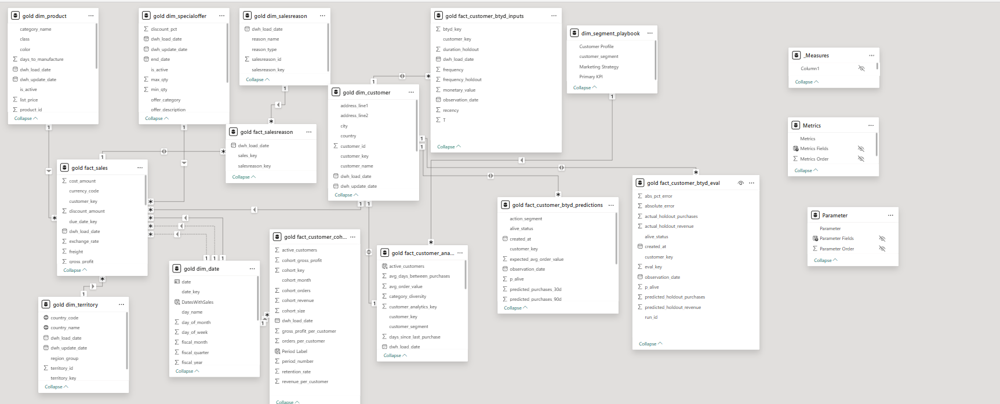
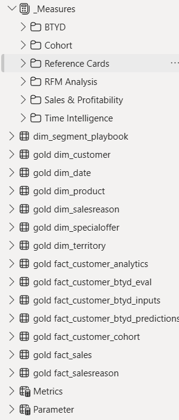
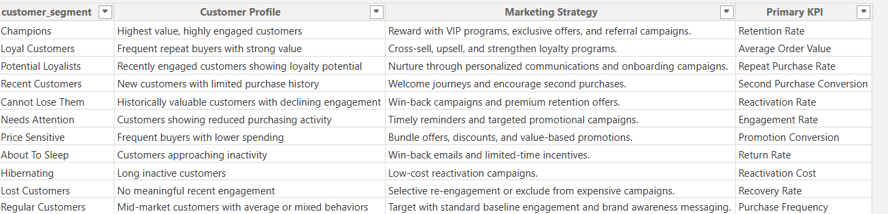

# 🧩 Phase 6: Semantic Model (Power BI)

The Power BI semantic model that sits on top of the Gold layer of the AdventureWorks2025 customer analytics warehouse. It turns the star-schema tables into business measures, reusable KPI logic and interactive report behaviour for the dashboards.

| | |
|---|---|
| **Source** | `AdventureWorks2025_CustomerDW`, Gold schema (SQL Server) |
| **Tables** | 17 (6 dimensions, 7 facts, 1 lookup, 2 field parameters, 1 measures table) |
| **Relationships** | 14 (2 of them inactive role-playing date relationships) |
| **DAX measures** | **60**, in 6 display folders |
| **Field parameters** | 2 |
| **Report pages fed** | Executive Summary, RFM, Cohort Retention, Customer Forecasting (BTYD) |

📄 All measures are in [`dax_measures.dax`](dax_measures.dax).

---

## 1) 🗺️ The Model



The model is a **constellation (multi-fact) star schema**: several fact tables share conformed dimensions, mainly `dim_customer` and `dim_date`. Each business question (sales, RFM, cohorts, BTYD forecasting) has its own fact table at its own grain, and the measures never mix grains inside one calculation.



---

## 2) 🗃️ Tables

### Dimensions (6)

| Table | Grain | Used for |
|---|---|---|
| `gold dim_customer` | one row per customer | customer attributes, shared filter for every customer-level fact |
| `gold dim_date` | one row per day | calendar, fiscal fields, time intelligence |
| `gold dim_product` | one row per product | category, subcategory, price and cost |
| `gold dim_territory` | one row per sales territory | geography |
| `gold dim_specialoffer` | one row per special offer | discount analysis |
| `gold dim_salesreason` | one row per sales reason | why customers bought |

### Fact tables (7)

| Table | Grain | Feeds |
|---|---|---|
| `gold fact_sales` | one row per order line | revenue, profit, orders, AOV (Executive Summary) |
| `gold fact_salesreason` | one row per order and sales reason | sales reason analysis |
| `gold fact_customer_analytics` | one row per customer | RFM scores and segments |
| `gold fact_customer_cohort` | one row per cohort month and period | retention matrix |
| `gold fact_customer_btyd_inputs` | one row per customer | BTYD model inputs (frequency, recency, T, monetary value, holdout) |
| `gold fact_customer_btyd_predictions` | one row per customer | model forecasts per customer |
| `gold fact_customer_btyd_eval` | one row per customer | forecast vs actual holdout |

### Supporting tables (4)

| Table | Type | Purpose |
|---|---|---|
| `_Measures` | measures-only table | home for all 60 measures, organised in display folders |
| `dim_segment_playbook` | static lookup | RFM segment → customer profile, marketing strategy, primary KPI |
| `Metrics` | field parameter | metric switcher on the Executive Summary |
| `Parameter` | field parameter | metric switcher on the cohort matrix |



---

## 3) 🔗 Relationships

All relationships are one-to-many from the dimension (one side) to the fact (many side) on integer surrogate keys, unless noted.

| One side | Many side | Key | Filter direction | Notes |
|---|---|---|---|---|
| `dim_customer` | `fact_sales` | `customer_key` | single | the `Customers` measure adds `CROSSFILTER(..., Both)` only where it is needed |
| `dim_product` | `fact_sales` | `product_key` | single | |
| `dim_territory` | `fact_sales` | `territory_key` | single | |
| `dim_specialoffer` | `fact_sales` | `specialoffer_key` | single | |
| `dim_date` | `fact_sales` | `order_date_key` | single | **active** |
| `dim_date` | `fact_sales` | `due_date_key` | single | inactive (dotted line), available with `USERELATIONSHIP` |
| `dim_date` | `fact_sales` | `ship_date_key` | single | inactive (dotted line), available with `USERELATIONSHIP` |
| `fact_sales` | `fact_salesreason` | `sales_key` | both | one sale can have several reasons |
| `dim_salesreason` | `fact_salesreason` | `salesreason_key` | single | |
| `dim_customer` | `fact_customer_analytics` | `customer_key` | both | one row per customer on both sides |
| `dim_customer` | `fact_customer_btyd_inputs` | `customer_key` | both | |
| `dim_customer` | `fact_customer_btyd_predictions` | `customer_key` | both | |
| `dim_customer` | `fact_customer_btyd_eval` | `customer_key` | both | |
| `dim_segment_playbook` | `fact_customer_analytics` | `customer_segment` | single | segment texts for the action panel |

### Why it is built this way

- **Role-playing dates.** `fact_sales` has three date keys (order, due, ship). Only the order date is active, so a date slicer behaves predictably; the other two stay available through `USERELATIONSHIP`.
- **Surrogate keys everywhere.** Every relationship uses integer keys created in the Gold layer, which keeps the model small and fast.
- **Customer-level facts share `dim_customer`.** One customer slicer filters RFM, BTYD and sales together.
- **Cohort table stands alone.** The cohort measures only use `fact_customer_cohort` (cohort month, period number, active customers, revenue), so the retention matrix does not depend on the sales fact.
- **Both-direction filters are used sparingly:** on the customer-level tables (one row per customer) and on the sales to sales-reason bridge, where they cannot create ambiguity.

---

## 4) 📐 DAX Measures (60)

| Display folder | Measures | What it covers |
|---|---|---|
| **Sales & Profitability** | 11 | Revenue, Orders, Customers, Quantity, Cost Amount, Discount Amount, Gross Profit, Gross Margin %, AOV, Avg Selling Price, Profit Per Order |
| **Time Intelligence** | 4 | Rolling 3-month averages of Revenue, Gross Profit, Customers and AOV |
| **Reference Cards** | 17 | Prior-year values, YoY %, arrow text and conditional-formatting colour for Revenue, Gross Profit, Customers and AOV cards |
| **RFM Analysis** | 11 | Purchased, High Value and At Risk customers, median days since purchase and purchase cycle, and the segment action panel (`MAC_*` measures) |
| **Cohort** | 12 | Retention and churn rate, active customers, revenue and profit per customer, orders per customer, new vs repeat revenue, repeat revenue share |
| **BTYD** | 5 | Predicted vs actual holdout purchases, projected 90-day revenue, model MAE, average p_alive |

### Patterns used

| Pattern | Where | How |
|---|---|---|
| **Base measures first** | Sales & Profitability | `Revenue`, `Orders`, `Gross Profit` are simple aggregations; ratios such as `AOV` and `Gross Margin %` reuse them with `DIVIDE` |
| **Prior-year comparison** | Reference Cards | `CALCULATE([Measure], DATEADD(dim_date[date], -1, YEAR))`, then `YoY % = DIVIDE(current - PY, PY)` |
| **Dynamic card formatting** | Reference Cards | the `Arrow` measure builds text like `+12.3%⤴` and the `Color` measure returns a hex colour used by conditional formatting (green ≥ +10%, lime 0 to +10%, amber 0 to -5%, red below -5%) |
| **Rolling window** | Time Intelligence | `DATESINPERIOD` over 3 months, averaging the daily value with `AVERAGEX` |
| **Matrix guards** | Cohort | `HASONEVALUE` on cohort month and period keeps subtotals blank where summing would mislead |
| **Dynamic text** | RFM | `SELECTEDVALUE` + `LOOKUPVALUE` read `dim_segment_playbook` to show a profile, strategy and KPI for the segment selected in the treemap |
| **Switchable visuals** | Field parameters | `Metrics` and `Parameter` use `NAMEOF` so one visual can show many measures |
| **Segment groups** | RFM | `At Risk` (About To Sleep, Hibernating, Lost) and `High Value` (Champions, Loyal) are defined once with `IN` |

### Field parameters

```dax
Metrics   = Revenue | Gross Profit | Customers | Gross Margin % | AOV
Parameter = Retention Rate | Churn Rate | Active Customers | Cohort Gross Profit | Gross Profit per Customer
```

---

## 5) 🧭 Design Choices

- **One measures table.** All measures live in `_Measures` and are grouped in display folders, so the field list stays clean for report authors.
- **Business logic in the model, not in visuals.** YoY logic, colour rules and segment texts are DAX measures, so every page that uses them behaves the same way.
- **Metadata-driven segment playbook.** Marketing strategy text sits in a table, not in DAX strings, so it can be edited without touching measures.
- **Gold layer does the heavy lifting.** RFM scoring, cohorts and BTYD inputs are calculated in SQL, so DAX stays simple and fast.

---

## 6) 📝 Note on the BTYD Measures

The five BTYD measures read the output tables written by the Python model in the next phase. In the final Python version `p_alive` is stored as `NULL` on purpose (the model could not estimate it), so `BTYD_Average_P_Alive` returns blank and is not shown on the report. The forecast cards compare predictions with a backtest holdout; see the Python phase documentation for how to read them.

---

## 7) 📁 Folder Contents

```
06_semantic_modeling/
├── README.md              ← this file
├── dax_measures.dax       ← all 60 measures + 2 field parameters
└── images/
    ├── semantic_model_diagram.png
    ├── model_tables_and_measure_folders.png
    └── dim_segment_playbook.png
```

**To reuse the measures:** open the model in Power BI Desktop, create a table named `_Measures`, and paste each measure from `dax_measures.dax` (or load the file into Tabular Editor).
